<div align="center">


# shelldeck

**Your terminals, organised by project.**<br>
Real shells in the browser, on your own machine, with your AI coding agents working side by side.

[](https://pypi.org/project/shelldeck/) [](https://pypi.org/project/shelldeck/) [](https://github.com/codejunction/shelldeck/actions/workflows/ci.yml) [](#install) [](https://github.com/codejunction/shelldeck/blob/main/LICENSE)

**[Install](#install)** · **[Terminals](#terminals)** · **[Projects](#projects)** · **[AI agents](#ai-agents)** · **[Tools](#tools)** · **[CLI](#cli)** · **[Remote access](#remote-access)** · **[Security](#security)**

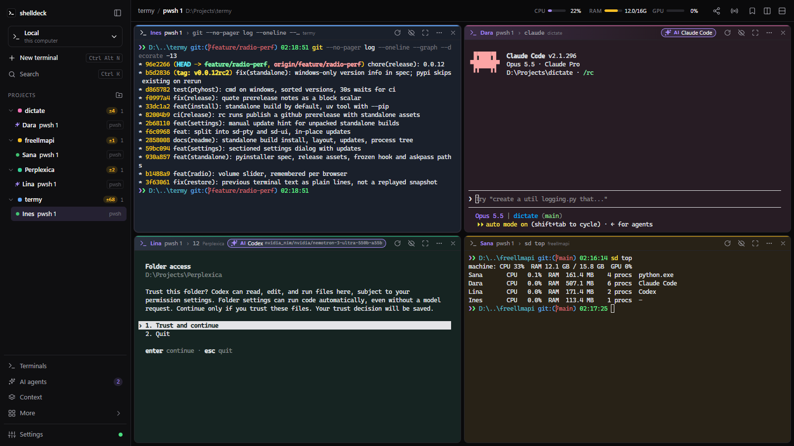

</div>

<table>
  <tr>
    <td width="33%" valign="top">
      <h3>Terminals that last</h3>
      PowerShell, cmd, Git Bash, WSL, bash, zsh, fish. Split or floating panes that keep running with the browser closed and come back after a reboot.
    </td>
    <td width="33%" valign="top">
      <h3>Grouped by project</h3>
      A colour per project, workspaces, VS Code <code>.code-workspace</code> import, git status at a glance, and SSH or RDP machines in the same sidebar.
    </td>
    <td width="33%" valign="top">
      <h3>Agents as a team</h3>
      Claude Code, Codex, Gemini, Devin and more, detected automatically. They hand work to each other, and the project remembers what they learned.
    </td>
  </tr>
</table>

## Install

| | Windows (PowerShell) | Linux |
| --- | --- | --- |
| **Standalone** (default) | `irm https://raw.githubusercontent.com/codejunction/shelldeck/main/install.ps1 \| iex` | `curl -fsSL https://raw.githubusercontent.com/codejunction/shelldeck/main/install.sh \| sh` |
| **uv tool** | `& ([scriptblock]::Create((irm https://raw.githubusercontent.com/codejunction/shelldeck/main/install.ps1))) -Pip` | `curl -fsSL https://raw.githubusercontent.com/codejunction/shelldeck/main/install.sh \| sh -s -- --pip` |

| | Standalone | uv tool |
| --- | --- | --- |
| Needs | nothing | Python 3.12+ via uv (also `pipx install shelldeck`, or `uvx shelldeck` to try it) |
| Updates | *Settings › Updates*, in place | `uv tool upgrade shelldeck` |
| Plugins | no | yes |

Requires Windows 10 1809+ (ConPTY) or Linux x64, and a modern browser. macOS gets the Python package and is untested.

```sh
sd                 # start shelldeck in the background and open it in your browser
sd ~/code/api      # add a folder as a project and open a terminal in it
```

The first visit asks you to create a password. Terminals keep running until you close them, even with the browser closed.

<details>
<summary><b>Standalone layout, installer options, updates</b></summary>

The installer downloads `shelldeck-<version>-windows-x64.zip` or `-linux-x64.tar.gz` from the latest [GitHub release](https://github.com/codejunction/shelldeck/releases), checks its `.sha256`, unpacks it into `%LOCALAPPDATA%\shelldeck` or `~/.local/share/shelldeck` and puts that folder on PATH:

```text
shelldeck/
  current.txt              the version in use, e.g. 0.0.12
  sd.cmd, sd               shims that run versions/<current>/sd, so `sd` and agent hooks survive updates
  versions/
    0.0.12/                shelldeck, sd-pty, sd-ui, sd (+ .exe on Windows) and _internal/
```

| Variable | Effect |
| --- | --- |
| `SHELLDECK_VERSION=0.0.12` | a specific release, release candidates included |
| `SHELLDECK_ROOT=<dir>` | install somewhere else |
| `SHELLDECK_NO_MODIFY_PATH=1` | leave PATH alone |
| `SHELLDECK_ARCHIVE=<file>` | install from a downloaded archive |

Running the installer again installs the newest release next to the old one.

**Updates.** Standalone: *Settings › Updates* (or the *Update now* toast) downloads the new release, checks its sha256, unpacks it next to the running one and restarts only the web app; terminals and their programs keep running. uv: `uv tool upgrade shelldeck`, then `sd restart`. Release candidates: `SHELLDECK_VERSION=0.0.13rc1` with the installer, or `uv tool install --force shelldeck==0.0.13rc1`.

**Processes.** `shelldeck` supervises `sd-pty`, which owns the shells, and `sd-ui`, the web app, which restarts on its own. Task Manager shows all three. `sd restart` restarts only the web app; `sd stop` stops everything.

</details>

## How it fits together

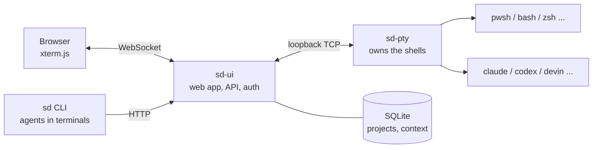

`sd-ui` can restart (updates, crashes) while `sd-pty` keeps every shell and agent running. Everything stays on your machine.

## Terminals

| Feature | What it does |
| --- | --- |
| **Real shells** | Windows: `pwsh`, Windows PowerShell, cmd, Git Bash, WSL (any distro). Linux: every shell in `/etc/shells`. |
| **Layouts** | Tiled splits (drag titles to split or swap, maximize) or floating windows on a canvas with *Tile all*. |
| **Nothing lost** | Closing the tab keeps terminals running. After a restart each one reopens in its last folder, its old text above a *restored* line. |
| **Shell integration** | The pane title shows the last command (red when it failed); `Ctrl+Shift+Up/Down` jumps between prompts. Your own prompt still loads. |
| **Background** | Hide a pane with `Ctrl+Alt+W` and it keeps running; `Ctrl+Alt+P` replays the last command. |
| **Links** | Port chips for dev servers; paths like `src/app.py:12:5` and tracebacks open in VS Code or the built-in editor. |
| **`?` and Ask** | Type `?` on an empty prompt for commands, bookmarks and plugins. Type a question and *Ask* has an agent's model write one command for that shell (Enter types it, Shift+Enter runs it). `Ctrl+I` opens just Ask; `sd ask "..."` prints it. |

<table>
  <tr>
    <td width="50%">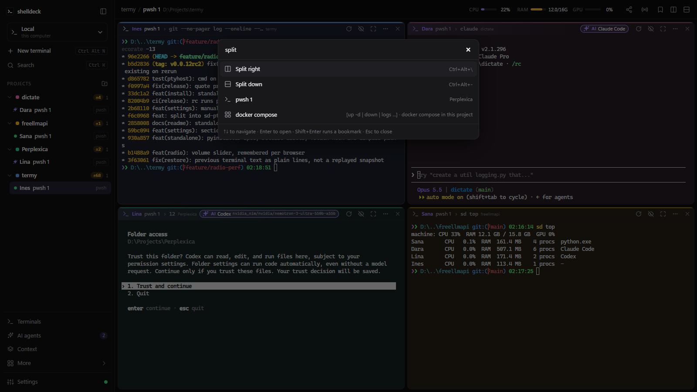</td>
    <td width="50%">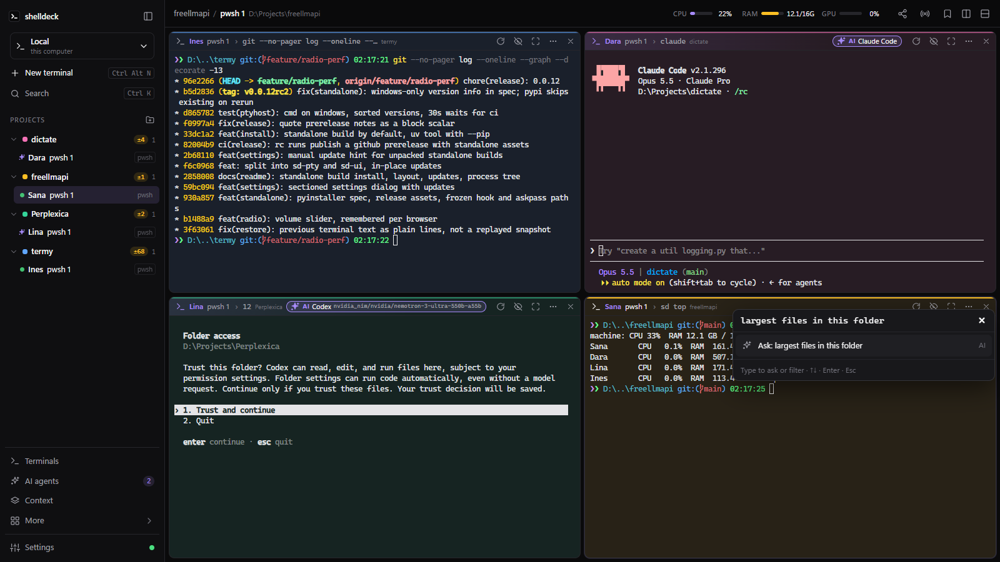</td>
  </tr>
  <tr>
    <td align="center"><sub><b>Command palette</b> · <code>Ctrl+Shift+P</code></sub></td>
    <td align="center"><sub><b>? menu with Ask</b> · right at the prompt</sub></td>
  </tr>
  <tr>
    <td>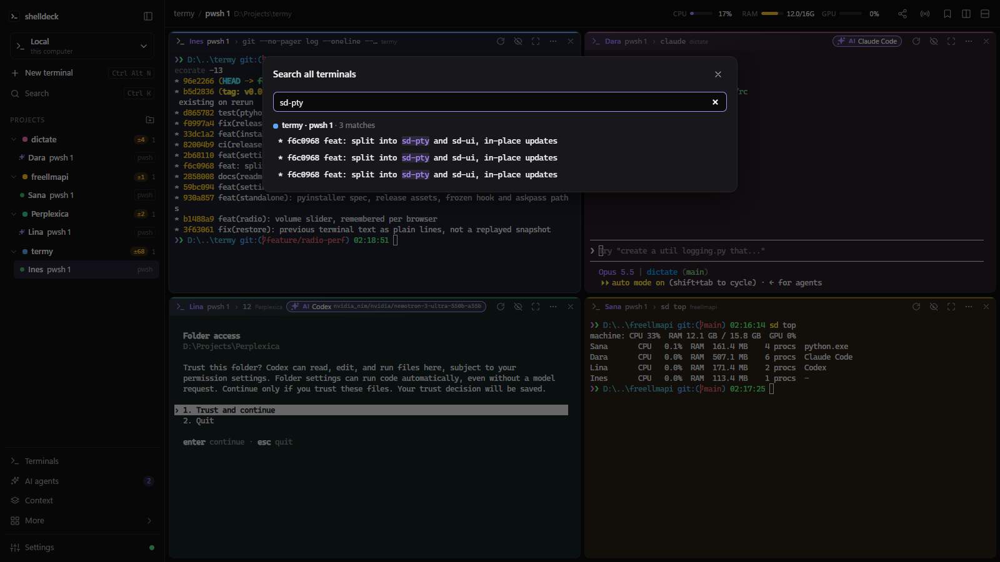</td>
    <td>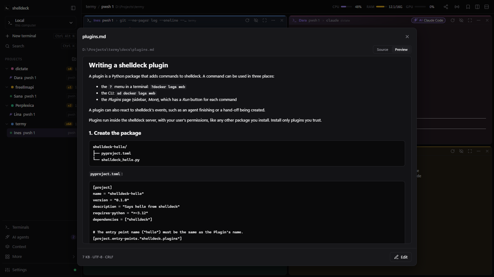</td>
  </tr>
  <tr>
    <td align="center"><sub><b>Search every terminal</b> · <code>Ctrl+Shift+F</code></sub></td>
    <td align="center"><sub><b>Editor and markdown viewer</b> · <code>sd edit</code>, <code>sd view</code></sub></td>
  </tr>
</table>

## Projects

| Feature | What it does |
| --- | --- |
| **Sidebar** | A colour per project (sidebar dot, pane border, background tint), added through a folder browser and reordered by drag. |
| **Workspaces** | Group projects under a name and show one group at a time from the *Projects* header. *Move to workspace…* sets one. |
| **VS Code workspaces** | A `.code-workspace` file adds each local folder in it as a project, in a workspace named after the file. Double-click it in the folder browser, paste its path, or run `sd open X.code-workspace`. Missing folders are listed, not dropped. |
| **Git** | A `±N` chip for uncommitted work; the git dialog shows changed files with diffs and the commit graph with one-click checkout. |
| **Machines** | Switch between this computer and SSH machines (Linux; key, agent or password, LDAP names like `CORP\jdoe`). Windows machines open as RDP desktops. *Test connection* checks network and login. Passwords are never stored. |

<table>
  <tr>
    <td width="50%">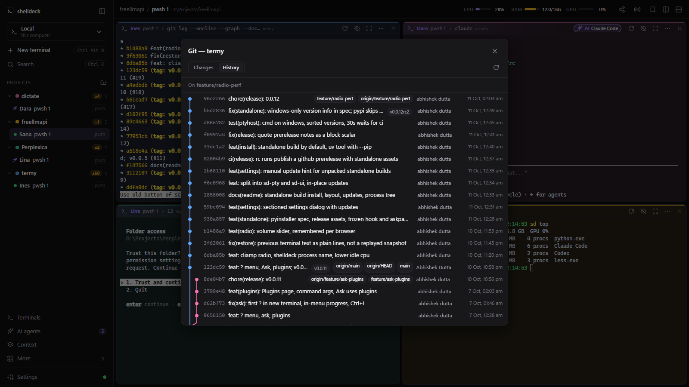</td>
    <td width="50%">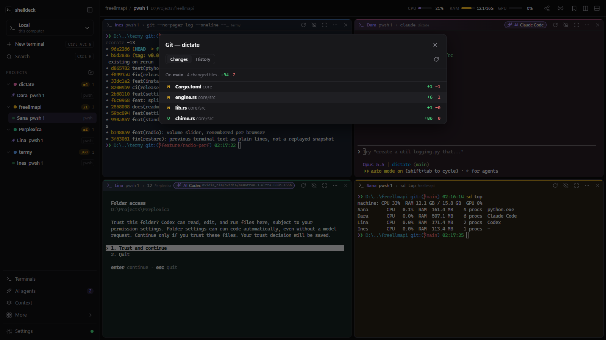</td>
  </tr>
  <tr>
    <td align="center"><sub><b>Git graph</b> · one-click checkout</sub></td>
    <td align="center"><sub><b>Changes</b> · uncommitted diffs</sub></td>
  </tr>
  <tr>
    <td>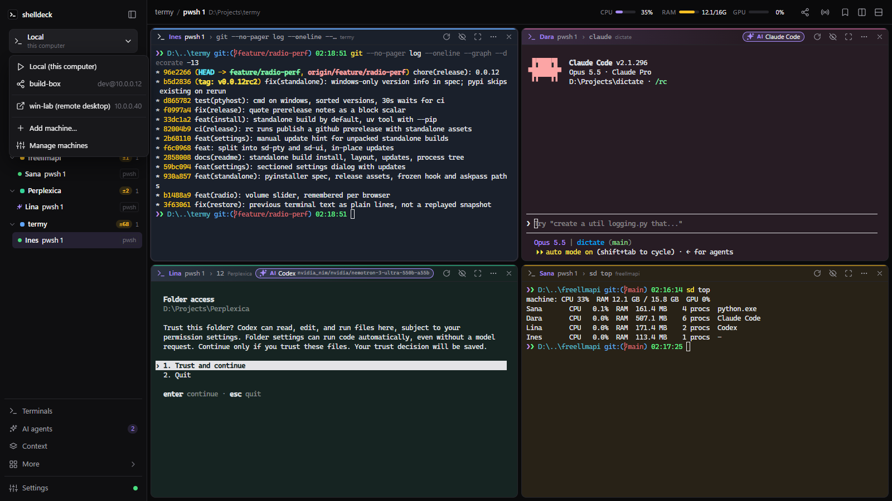</td>
    <td>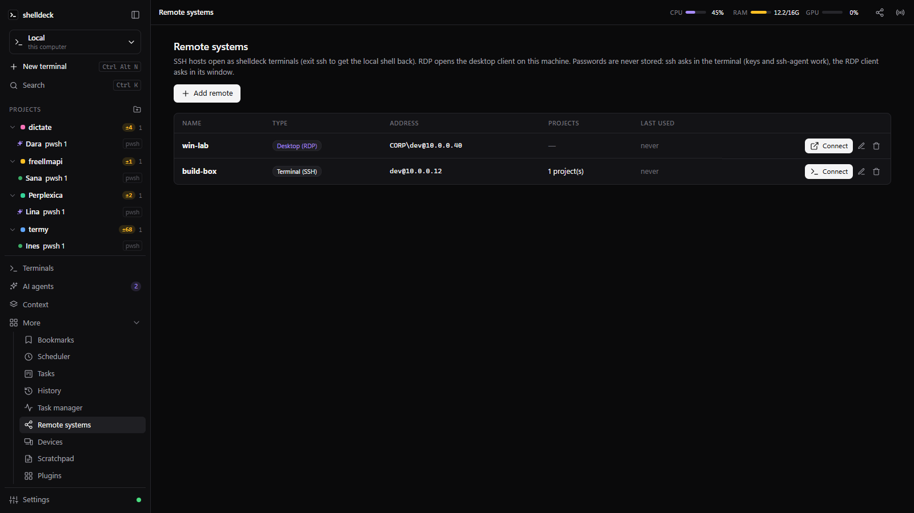</td>
  </tr>
  <tr>
    <td align="center"><sub><b>Machine picker</b></sub></td>
    <td align="center"><sub><b>Remote systems</b> · SSH and RDP</sub></td>
  </tr>
</table>

## AI agents

Agents running in shelldeck terminals see each other, hand work to each other, and leave what they learned for the next one.

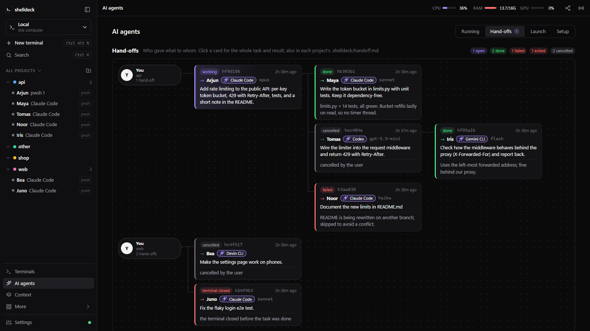

<p align="center"><sub><b>Hand-offs</b> · who gave what to whom, chains nested to the right, coloured by how they ended</sub></p>

| Feature | What it does |
| --- | --- |
| **Detected** | Claude Code, Codex, Devin, Gemini, Copilot, Cursor Agent, opencode, Aider, Amp, Qwen, Goose, Droid, Crush and Kiro get an **AI** chip with the model and how full the context window is. |
| **Needs you** | Only when an agent asks something (a permission prompt, a question, `[y/n]`): an amber chip, a chime and a notification. The sidebar ranks agents by who needs you. |
| **Exact state** | `sd integration install` hooks Claude Code, Codex, Gemini and Devin so they report `working` / `blocked` / `done` and can be resumed after a restart. 15 more have preview hooks. See [docs/agent-integrations.md](docs/agent-integrations.md). |
| **Teamwork** | Each terminal has a name (Maya, Kofi…). From inside one: `sd agents`, `peek`, `tell`, `spawn "task" --model small\|medium\|large`, `handoff` and `done`. A sub-agent's questions go to its parent, not to you. |
| **Hand-offs** | The *Hand-offs* tab draws every hand-off as a card on a tree; click one for the full task and result, or cancel it. You can hand off too, from a running agent's *Actions* menu. |
| **Context** | Each project keeps a task, next step, facts, decisions and activity (commands, tests, edited files; never output or secrets) locally and in `.shelldeck/*.md`. A new agent runs `sd context` and continues. `sd recall` searches every project. No model runs inside shelldeck. |

<table>
  <tr>
    <td width="50%">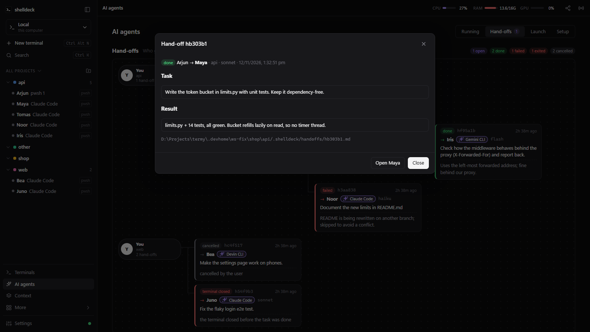</td>
    <td width="50%">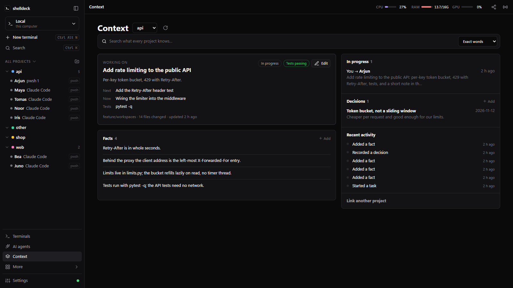</td>
  </tr>
  <tr>
    <td align="center"><sub><b>A hand-off in full</b> · task, result, open the terminal</sub></td>
    <td align="center"><sub><b>Context</b> · what the project is working on</sub></td>
  </tr>
</table>

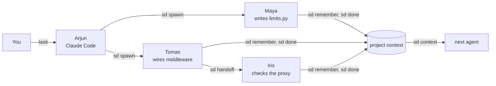

## Tools

| Tool | What it does |
| --- | --- |
| **Task manager** | `Ctrl+Alt+M`, `sd top`: CPU, RAM and NVIDIA GPU for the machine and each terminal's process tree. |
| **Bookmarks** | Commands per project; insert, or Shift+Enter to run. |
| **Scheduler** | Cron jobs in a project folder, with logs. |
| **Tasks** | A board with due dates, reminders and *Send to agent*. |
| **History** | Every command with exit code, duration and folder. |
| **Scratchpad** | Markdown notes; agents add with `sd notes`. |
| **Devices** | Every signed-in browser, which one is in use, and *Sign out*. |
| **Radio** | [cliamp](https://cliamp.stream) channels in the top bar, streamed by your browser. |

<table>
  <tr>
    <td width="50%">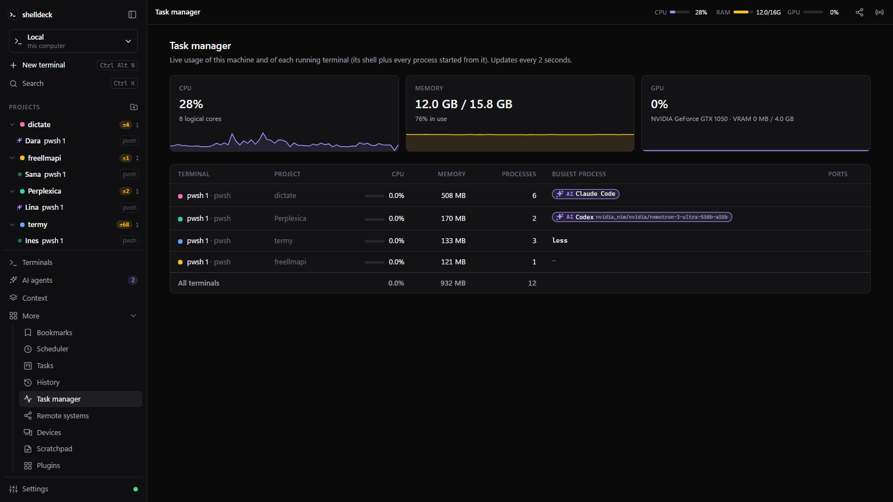</td>
    <td width="50%">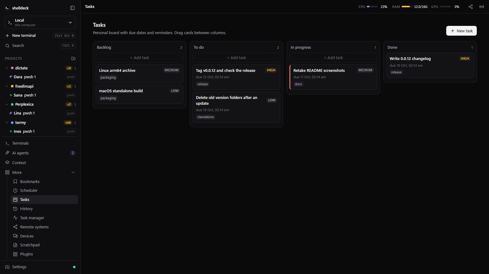</td>
  </tr>
  <tr>
    <td align="center"><sub><b>Task manager</b> · per terminal</sub></td>
    <td align="center"><sub><b>Task board</b></sub></td>
  </tr>
</table>

<details>
<summary><b>More screenshots</b> · bookmarks, scheduler, history, scratchpad, settings, radio, share, devices</summary>

<table>
  <tr>
    <td width="50%">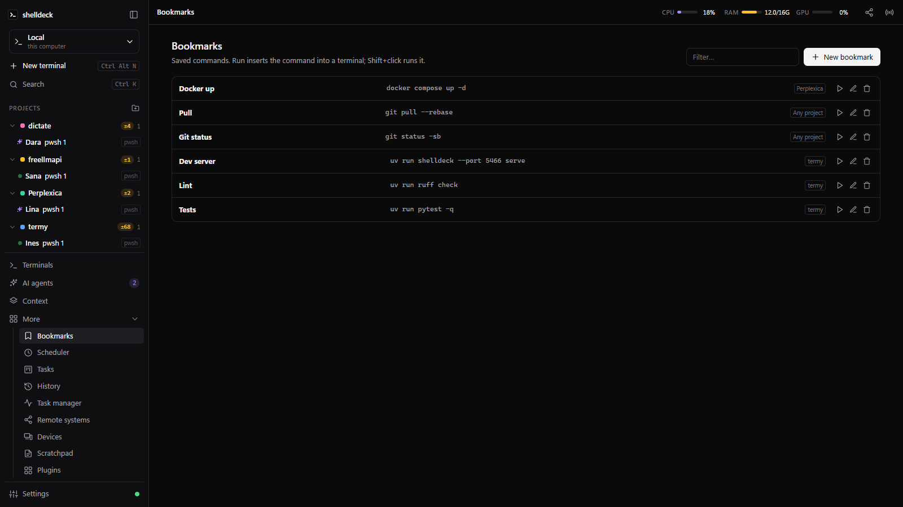</td>
    <td width="50%">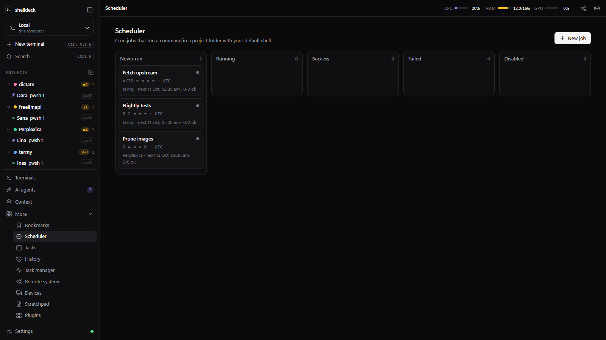</td>
  </tr>
  <tr>
    <td align="center"><sub><b>Bookmarks</b></sub></td>
    <td align="center"><sub><b>Scheduler</b></sub></td>
  </tr>
  <tr>
    <td>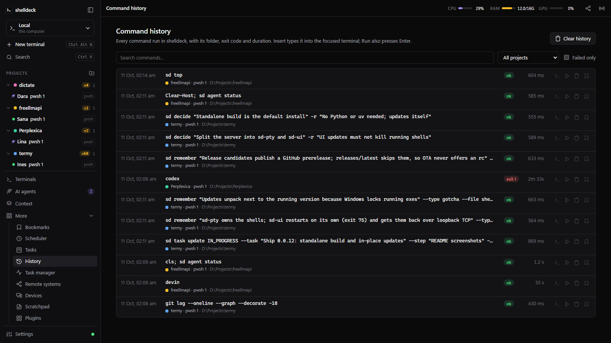</td>
    <td>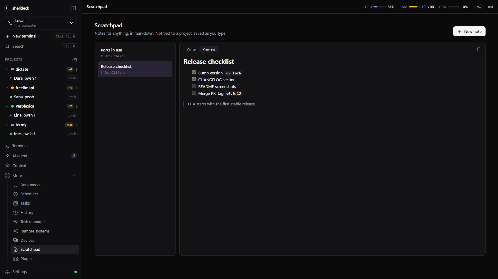</td>
  </tr>
  <tr>
    <td align="center"><sub><b>Command history</b></sub></td>
    <td align="center"><sub><b>Scratchpad</b></sub></td>
  </tr>
  <tr>
    <td>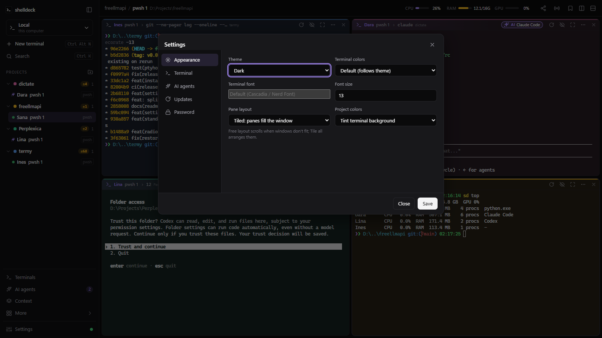</td>
    <td>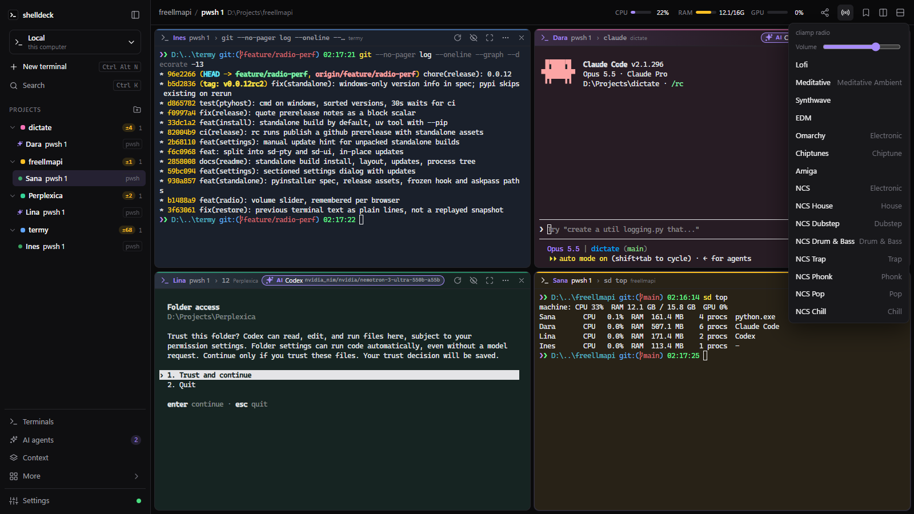</td>
  </tr>
  <tr>
    <td align="center"><sub><b>Settings</b></sub></td>
    <td align="center"><sub><b>Radio</b></sub></td>
  </tr>
  <tr>
    <td>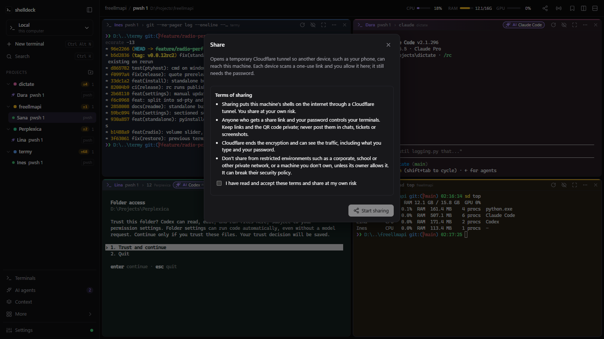</td>
    <td>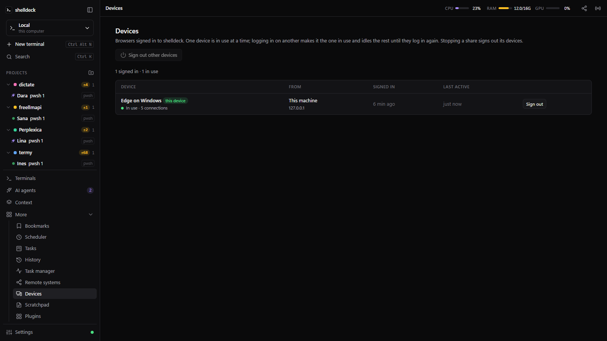</td>
  </tr>
  <tr>
    <td align="center"><sub><b>Share</b> · Cloudflare tunnel</sub></td>
    <td align="center"><sub><b>Devices</b></sub></td>
  </tr>
</table>

</details>

### Plugins

A plugin is a Python package with a `shelldeck.plugins` entry point. Its commands show up in the `?` menu (`?docker logs web`) and the CLI (`sd docker logs web`), and return text to show or a command line to type.

```python
# pyproject.toml: [project.entry-points."shelldeck.plugins"]  docker = "shelldeck_docker:plugin"
from shelldeck.plugins import Plugin

plugin = Plugin("docker", "0.1.0")

@plugin.command("logs", "Follow a container's logs", usage="<container>")
def logs(args, ctx):  # ctx: session_id, cwd, shell, project
    return {"input": "docker logs -f " + " ".join(args)}
```

Install into shelldeck's environment (`uv tool install shelldeck --with ./examples/shelldeck-docker`) and restart. The *Plugins* page and `sd plugin list|enable|disable` manage them. Plugins run with your permissions; install only ones you trust. Guide: [docs/plugins.md](docs/plugins.md).

<details>
<summary><b>Keyboard shortcuts</b></summary>

| Keys | Action |
| --- | --- |
| `Ctrl+Shift+P` | Command palette (`Ctrl+K` also works outside a terminal) |
| `Ctrl+Alt+N` | New terminal in the current project |
| `Ctrl+Alt+\` / `Ctrl+Alt+-` | Split right / down |
| `Ctrl+Alt+Arrows` | Focus the pane in that direction |
| `Ctrl+Alt+1…9` | Focus pane 1–9 |
| `Ctrl+Alt+Enter` | Maximize / restore the pane |
| `Ctrl+Alt+Q` | Close the focused terminal (offers the background when a command runs) |
| `Ctrl+Alt+P` | Replay the last command |
| `Ctrl+Alt+W` | Send the terminal to the background (keeps running) |
| `Ctrl+Alt+B` | Bookmark picker (Space selects several, Shift+Enter runs) |
| `Ctrl+Alt+E` | Toggle the sidebar |
| `Ctrl+Alt+S` / `Ctrl+Alt+T` | Scheduler / Tasks |
| `Ctrl+Alt+M` | Task manager |
| `Ctrl+Alt+R` | Command history |
| `Ctrl+Shift+F` | Search all terminals |
| `?` / `Ctrl+I` (empty shell prompt) | Command menu with Ask / just the Ask box |
| `Ctrl+Alt+,` | Settings |
| `Ctrl+Alt+L` | Lock |
| `Ctrl+Alt+H` | Show shortcuts |
| `Ctrl+C` / `Ctrl+V` | Copy the selection (otherwise sends Ctrl+C) / paste |
| `Ctrl+F` | Find in the terminal |
| `Ctrl+Shift+Up` / `Down` | Jump to the previous / next prompt |

In the sidebar, Ctrl+click or middle-click a terminal to open it in a split. Right-click a project or terminal for its menu.

</details>

<details>
<summary><b>Settings</b></summary>

| Setting | Values | Default |
| --- | --- | --- |
| Theme | dark, light, system | dark |
| Terminal colors | default (follows theme), Dracula, One Dark, Nord, Gruvbox Dark, Solarized Dark, Solarized Light, GitHub Light | default |
| Terminal font / size | any installed monospace font / 8–32 | Cascadia or Nerd Font / 13 |
| Pane layout | tiled, free | tiled |
| Project colors | tint on, off | on |
| Default shell | Windows: pwsh, powershell, cmd, gitbash, wsl · Linux: shells from `/etc/shells` | pwsh / `$SHELL` |
| WSL distribution | any installed distro, or the system default | system default |
| Open file paths with | VS Code (at the line), shelldeck's editor, system default app | VS Code |
| Ask agent / Ask model | first installed, Claude Code, Codex, Gemini CLI, Devin CLI / that agent's models | first installed / its smallest |
| Smart search | off, first installed agent, Claude Code (haiku), Codex, Gemini CLI (flash-lite), Devin CLI | off |
| Resume agent sessions after a restart | ask, automatically, never | ask |
| Updates | installed and latest version, *Update* (standalone) | |
| Password | created on first visit, changed here (current + new) | required |

</details>

## CLI

<table>
  <tr>
    <th align="left" width="50%">Everyday</th>
    <th align="left" width="50%">Agents and context</th>
  </tr>
  <tr>
    <td valign="top">

```text
sd                   start and open the browser
sd PATH              add a project, open a terminal
sd X.code-workspace  import every folder in it
sd list / sd info    terminals / the one you're in
sd restart           restart the web app only
sd stop              stop everything
sd top / ps / kill   task manager
sd edit / view FILE  built-in editor / viewer
sd search QUERY      LLM-free code search
sd share             share over a tunnel
```

</td>
    <td valign="top">

```text
sd agents               agents in this project
sd peek / tell NAME     read / type into a terminal
sd spawn "TASK"         sub-agent in a new pane
sd handoff NAME "T"     give a task to an agent
sd done ID "RESULT"     close a hand-off
sd context              task, facts, decisions
sd remember FACT        save what you learned
sd recall QUERY         search every project
sd ask "QUESTION"       one command for this shell
sd integration install  exact agent state
```

</td>
  </tr>
</table>

<details>
<summary><b>Full command reference</b></summary>

```text
sd [--port N] [--no-window] [--app]  start the server if needed, print the banner and open the browser (= sd web)
sd PATH / sd open [PATH] [--shell S] add PATH as a project and open a terminal in it (a .code-workspace file adds every folder in it)
sd list / sd info                    terminals grouped by project / the terminal you're in
sd restart / sd stop                 restart the web app (terminals keep running) / stop everything
sd serve [--host H]                  run the server in the foreground

sd agents [--all]                    AI agents in this project's terminals (--all: everywhere, plus installed CLIs)
sd peek TERMINAL [-n 40]             last lines of another terminal (by name like Maya, id or title)
sd tell TERMINAL "MESSAGE"           type a message into another terminal and press Enter
sd spawn "TASK" [--agent A] [--model small|medium|large|auto|NAME]   sub-agent in a new terminal
sd handoff TERMINAL "TASK" / sd done ID ["SUMMARY"] [--failed] / sd handoffs [--all]
sd answer TERMINAL KEY...            press keys in another terminal (1, y enter, esc)
sd close TERMINAL [--force]          close a terminal; from an agent only its own sub-agents
sd agent status|wait|start|prompt|rename|cmd|explain|resume|report|extract ...   agent lifecycle
sd integration list|detect|status|install|uninstall [AGENT] [--all]   lifecycle hooks
sd events subscribe [--types agent,handoff] [--since ID]   JSON lines of agent.*, handoff.* events

sd init [PATH] [--task TEXT]         set up .shelldeck/ (STATE, TASK, MEMORY, DECISIONS, AGENTS.md)
sd context [PROJECT] / sd resume     task, state, next action, memory, decisions, events
sd remember FACT... / sd discover FINDING / sd decide TITLE [-r REASON] / sd memory
sd task update [STATUS] [--task --step --next --tests --error]
sd recall QUERY [--smart | --agent A [--model M]]   search every project
sd switch AGENT [--note TEXT]        continue this project's task with another agent
sd ask "QUESTION"                    print one command for this terminal's shell and OS

sd notes list|add|append|show|replace|delete   Scratchpad
sd top / sd ps [TERMINAL] / sd kill TERMINAL PID [--force]   Task manager
sd edit FILE / sd view FILE          open a file in shelldeck's editor / viewer
sd search QUERY [--root DIR]         LLM-free code search with ranked snippets
sd render FILE                       pretty-print code or markdown
sd schedule list|add|run|toggle|delete|logs
sd task list|add|move|delete|alarms
sd plugin list|enable|disable|run    plugins; `sd <plugin> <command>` runs one
sd install-skill [AGENT...] [--remove]   teach agent CLIs the sd commands (automatic on start)
sd share [stop] [--new-link]         share over a Cloudflare tunnel (see Remote access)
sd login-link / sd reset-password    emergency, host only
```

- Default port `5455` (`--port` or `SHELLDECK_PORT`). `--app` opens a chromeless Edge/Chrome window.
- Inside a terminal: `SHELLDECK_SESSION_ID`, `SHELLDECK_NICK`, `SHELLDECK_PORT`, `SHELLDECK_AGENT_REPORT_TOKEN`, and `SHELLDECK_PARENT` for sub-agents.
- To let Claude Code sub-agents report back on their own, allow `Bash(sd:*)` in its permissions.

</details>

## Remote access

| Way | Setup | Who sees the traffic |
| --- | --- | --- |
| **SSH tunnel** (recommended) | `sd serve` on the VM, `ssh -N -L 5455:127.0.0.1:5455 you@vm` locally | only you |
| **`sd share`** | [`cloudflared`](https://developers.cloudflare.com/cloudflare-one/connections/connect-networks/downloads/) on PATH, no account | Cloudflare (it ends TLS) |
| **iPhone / iPad app** | scan the share QR once | only you (end-to-end encrypted) |
| **HTTPS on the VM** | `sd serve --host 0.0.0.0 --cert cert.pem --key key.pem` | only you |

### `sd share`

```sh
sd share              # prints a QR code and a link; Ctrl+C stops sharing
sd share --new-link   # another one-use link for a second device
sd share stop
```

Or use the **Share** button in the top bar.

- Each link works **once**, for **10 minutes**. The device then waits until you allow it here. It shows a 4-digit code and so does the Allow prompt (toast, Devices, `sd share`): allow only if they match. The password is still required (12+ characters for sharing).
- Cloudflare ends TLS, so in a browser it can see the traffic. For sensitive work in a browser use SSH or Tailscale, or the iPhone/iPad app.
- The first share asks you to accept the terms. Stopping a share signs out every browser that came through it.

### iPhone and iPad

The native app in [`ios/`](ios/README.md) is built and installed from Windows + WSL with [xtool](https://github.com/xtool-org/xtool). A free Apple ID is enough; no Mac or paid developer account. It has **Terminals** (SwiftTerm, with each agent's state), **System**, **Schedule**, **Scratchpad** and **Settings** (several PCs, alert sounds). On iPad, projects sit in a sidebar with up to four tiled terminals.

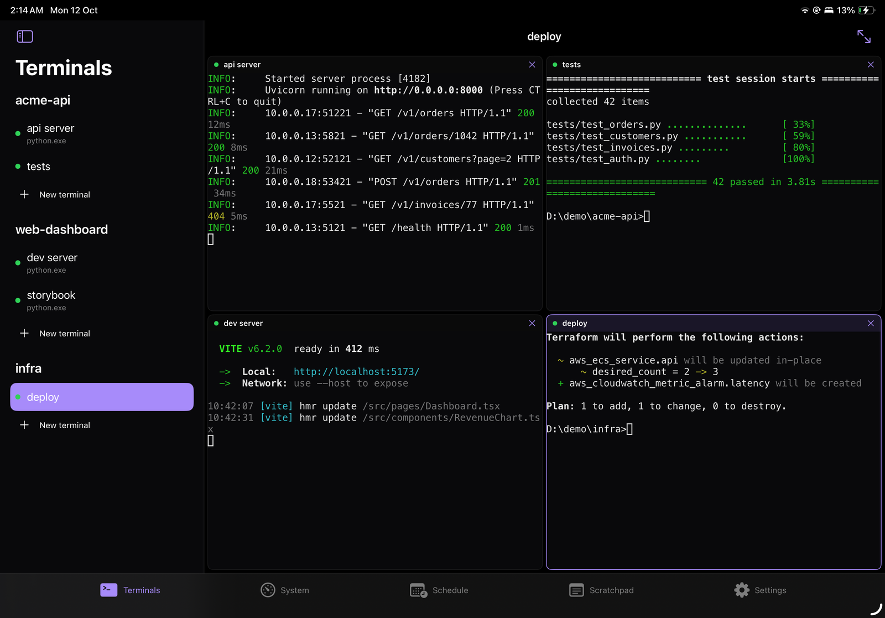

<table>
  <tr>
    <td width="25%">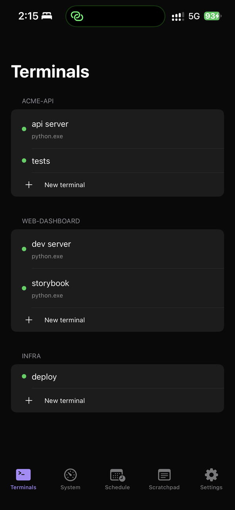</td>
    <td width="25%">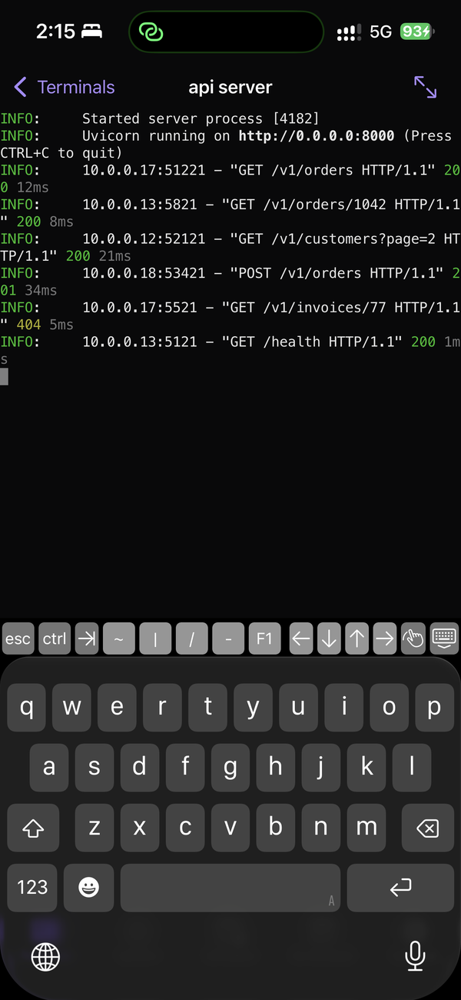</td>
    <td width="25%">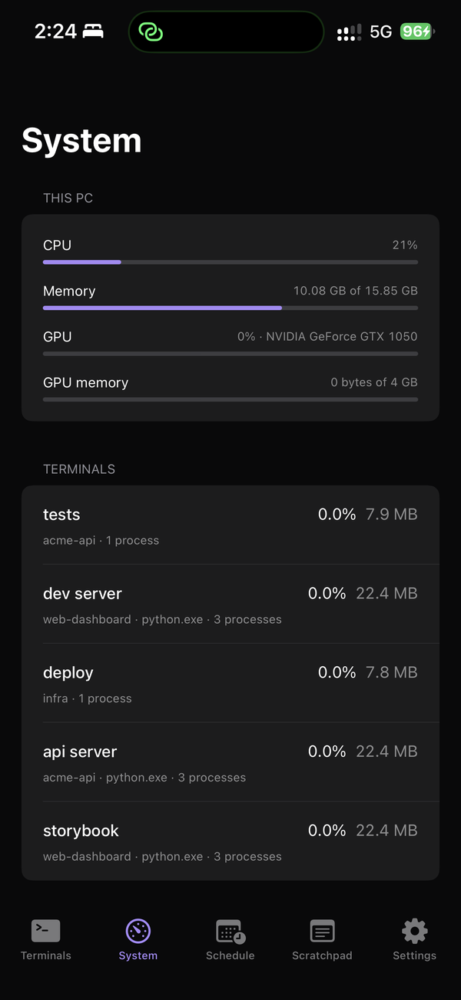</td>
    <td width="25%">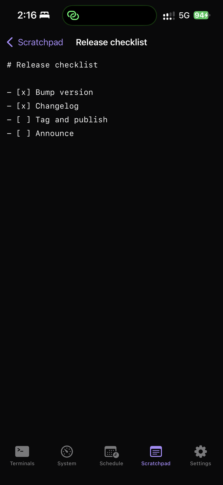</td>
  </tr>
</table>

| Topic | How it works |
| --- | --- |
| **Connecting** | Scan the share's QR once and allow the device. It is then **trusted**: it finds every new share by itself, with no QR or approval (the password is still asked). New share addresses reach it through [ntfy.sh](https://ntfy.sh), encrypted with a key only your PC and the device hold. |
| **End to end** | The QR carries the PC's public key after `#`, which never leaves the phone. All app traffic (API, terminals, your password) goes through one X25519 + AES-256-GCM channel to that key; Cloudflare and your Wi-Fi see only ciphertext. |
| **Several devices** | An iPhone and an iPad on the same Apple ID share their trusted PCs through iCloud Keychain. |
| **Managing** | The Devices page lists trusted devices and revokes them; a new one raises an alert on the PC. |
| **Free Apple ID limits** | Reinstall every 7 days (`ios/scripts/install.sh`); alerts ring only while the app is open. |

Setup and installing it for someone else: [ios/README.md](ios/README.md).

Plain HTTP on a non-local address is refused (`--insecure-http` overrides), and a first visit from another machine also needs the setup code `sd serve` prints. On phone browsers a key bar adds Esc, Tab, Ctrl and arrows, and dialogs open as bottom sheets.

## Security

| Guard | What it does |
| --- | --- |
| **Local only** | Binds to `127.0.0.1` and rejects requests whose `Host` or `Origin` isn't the app, so other websites can't reach your shells. Responses forbid framing, sniffing and referrers. |
| **Password** | Required. PBKDF2-SHA256 (600k iterations); logins are `HttpOnly`, `SameSite=Strict` cookies stored as SHA-256; failed logins slow down; 30 minutes idle locks the browser. |
| **One device at a time** | Logging in elsewhere takes over and idles the rest; the Devices page revokes any login. |
| **CLI** | A token file readable only by your account, rotated on every start. |
| **Sharing** | Shut until you allow a device whose matching code you checked. Through the tunnel, responses send HSTS and the cookie is `Secure`. Trusted app devices skip only the approval, never the password. |
| **iPhone / iPad** | Only an end-to-end encrypted channel (X25519 + AES-256-GCM, key pinned from the QR). Neither the tunnel nor ntfy.sh can read or forge it. |
| **Forgot the password** | On the host: `sd login-link` (one-time URL, 5 minutes) or `sd reset-password`. Never from the browser. |
| **Your data** | `~/.config/shelldeck/` (`SHELLDECK_HOME` moves it). |

Found a vulnerability? Report it privately; see [SECURITY.md](https://github.com/codejunction/shelldeck/blob/main/SECURITY.md).

## Development

```sh
git clone https://github.com/codejunction/shelldeck && cd shelldeck
uv sync
uv run shelldeck --port 5466 serve     # dev server, http://127.0.0.1:5466
uv run pytest -q                       # includes a real PTY round trip
uv run ruff check
```

FastAPI and uvicorn, `pywinpty` (ConPTY) or the stdlib `pty`, SQLite, and plain HTML/CSS/JS with vendored xterm.js (no build step). See [CONTRIBUTING.md](https://github.com/codejunction/shelldeck/blob/main/CONTRIBUTING.md).

## License

[MIT](https://github.com/codejunction/shelldeck/blob/main/LICENSE). xterm.js is MIT-licensed too (see `shelldeck/static/vendor/LICENSE-xterm.txt`).
